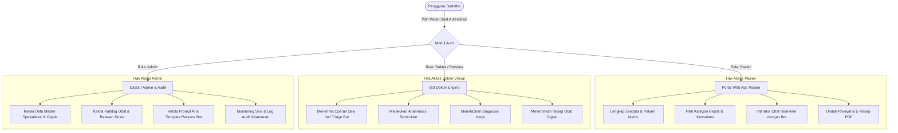
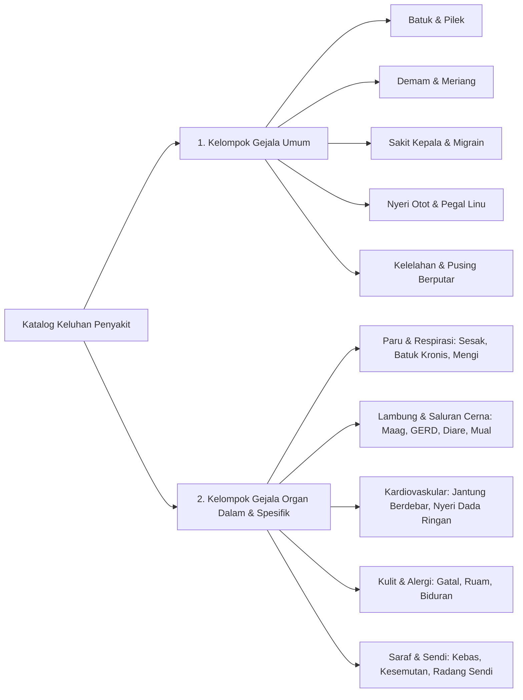

# 📑 Dokumen Spesifikasi Kebutuhan Produk (PRD) & Logika Bisnis
## Proyek: Medicare Consult (Telehealth Platform)
> **Penyusun Utama:** Maulid (Lead Business Analyst)  
> **Penanggung Jawab Proyek:** Alpian (Project Leader)  
> **Modul:** 01 — Business Logic & PRD

---

## 1. 🏥 Latar Belakang & Studi Kasus Sistem

### 1.1 Permasalahan Nyata Pengguna
Dalam kehidupan sehari-hari, ketika seseorang merasakan gejala sakit (seperti flu, demam, sakit kepala, batuk, asam lambung kambuh, atau sesak napas ringan), dorongan utama mereka adalah:
> *"Saya sedang sakit, saya ingin segera tahu apa kemungkinan penyakit saya dan obat apa yang aman untuk segera diminum tanpa harus menghabiskan waktu berjam-jam antre di klinik/rumah sakit."*

Namun, terdapat hambatan besar dalam perilaku masyarakat:
1. **Self-Diagnosis Berbahaya di Internet**: Mencari gejala di mesin pencari umum seringkali menghasilkan informasi menakutkan (*cyberchondria*) atau memicu pembelian obat keras sembarangan tanpa petunjuk dosis yang tepat.
2. **Keterbatasan Akses Dokter Cepat**: Pada malam hari atau situasi mendesak, mendapatkan konsultasi dokter spesialis membutuhkan biaya besar dan waktu tunggu reservasi yang lama.
3. **Ketiadaan Dokumen Resep Resmi**: Membeli obat bebas terbatas di apotek tanpa catatan rekomendasi dosis tertulis berisiko menimbulkan salah dosis atau efek samping interaksi obat dengan riwayat alergi pasien.

### 1.2 Studi Kasus: Medicare Consult
**Medicare Consult** hadir sebagai solusi berbasis *telemedicine* interaktif dengan pendekatan **Dual-Bot AI Mediation** (terinspirasi dari efisiensi ekosistem Halodoc).

Perubahan mendasar (*pivot*) dari konsep awal:
- **Sebelumnya**: Pengelolaan jadwal kunjungan ke klinik fisik (*offline clinic management*).
- **Kini**: Konsultasi kesehatan daring murni (*full online teleconsultation*), di mana pasien berinteraksi secara real-time dengan dokter virtual berbasis spesialisasi, memperoleh edukasi medis, dan menerima **Resep Digital (PDF)** resmi yang dapat dicetak dan ditebus di apotek terdekat.

---

## 2. 🔍 Analisis Komparasi: Halodoc vs. Medicare Consult

Untuk memastikan sistem memiliki dasar logika bisnis yang matang, dilakukan perbandingan fitur dan alur operasional antara platform industri (**Halodoc**) dengan **Medicare Consult**:

| Dimensi Sistem | Halodoc (Benchmark Industri) | Medicare Consult (Solusi Kami) | Keunggulan Inovasi Medicare Consult |
|---|---|---|---|
| **Penyedia Konsultasi** | Dokter asli (manusia nyata) | **Bot Dokter Berbasis Gemini AI Persona** | Ketersediaan instan 24/7 tanpa antre, bebas biaya konsultasi mahal, latensi respons hitungan detik. |
| **Alur Seleksi Dokter** | Pasien memilih manual dokter dari daftar panjang berdasarkan rating/harga | **Bot Penengah (*Triage Agent*)** | Pasien cukup memilih gejala; bot penengah yang menganalisis dan mengarahkan otomatis ke spesialisasi yang tepat. |
| **Prasyarat Konsultasi** | Opsional melengkapi biodata sebelum chat | **Ketat (*Mandatory Gatekeeper*)** | Pasien **wajib 100% melengkapi rekam medis** (alergi, umur, BB/TB) sebelum sesi dapat dibuka, menjamin keselamatan klinis bot. |
| **Output Konsultasi** | Ringkasan resep digital di dalam aplikasi untuk ditebus ke apotek internal Halodoc | **E-Resep Digital PDF Terstandar** | Dapat diunduh sebagai berkas PDF resmi ber-QR Code untuk dicetak dan ditebus di **apotek fisik rekanan mana pun** di sekitar pasien. |
| **Segmentasi Gejala** | Berdasarkan spesialisasi dokter yang rumit bagi orang awam | **Dua Kategori Intuitif**: Gejala Umum vs Gejala Organ Dalam | Sangat mudah dipahami orang awam tanpa harus bingung memilih jenis spesialisasi kedokteran di awal. |
| **Arsitektur Antarmuka** | Aplikasi seluler (Android/iOS) | **Web Portal Terpisah**: *Landing Page* publik $\leftrightarrow$ *Web App CRM* privat | Pengalaman pengguna terfokus; *landing page* ramah pencarian, sementara *web app* ramah produktivitas konsultasi. |

---

## 3. 👥 Matriks Hak Akses Pengguna (Role-Based Access Control / RBAC)

Sistem dirancang dengan 3 peran (*roles*) dengan batasan hak akses yang tegas:

### 3.1 Peran: Pasien (*Patient*)
- Mendaftar dan masuk akun melalui *Landing Page*.
- Mengisi dan memperbarui formulir biodata medis wajib (NIK, tanggal lahir, jenis kelamin, golongan darah, tinggi/berat badan, riwayat alergi obat, dan penyakit kronis penyerta).
- Memilih kategori gejala keluhan (Umum vs Organ Dalam).
- Berbincang dengan **Bot Penengah (*Triage Bot*)** untuk perumusan keluhan utama.
- Melanjutkan konsultasi interaktif dengan **Bot Dokter Spesialis** melalui antarmuka chat real-time.
- Memperoleh kesimpulan diagnosis klinis awal dan instruksi perawatan mandiri.
- Mengunduh dokumen **E-Resep PDF** yang dapat dicetak.
- Melihat riwayat seluruh sesi konsultasi sebelumnya di menu *Medical Records*.

### 3.2 Peran: Dokter (*AI Doctor Persona*)
- Diwujudkan dalam bentuk agen cerdas (*intelligent agents*) yang terdaftar dalam database dengan spesialisasi tertentu (misal: dr. Farah Sp.P untuk Paru, dr. Hendra Sp.PD untuk Penyakit Dalam, dr. Budi Sp.A untuk Anak, dsb.).
- Menerima rangkuman konteks anamnesis awal yang dioper oleh *Triage Bot*.
- Mengajukan pertanyaan terstruktur (metode SOCRATES: *Site, Onset, Character, Radiation, Associations, Time course, Exacerbating/relieving factors, Severity*).
- Menghasilkan anjuran medis dan resep obat yang terkunci pada katalog obat aman (golongan hijau dan biru).
- Menandatangani resep secara digital melalui *token verification hash*.

### 3.3 Peran: Administrator (*System Admin*)
- Mengelola data master kategori gejala dan sub-gejala.
- Mengelola data master spesialisasi medis dan profil bot dokter (nama, nomor SIP virtual, foto, *system prompt*).
- Mengelola katalog farmasi (daftar nama obat, sediaan obat, indikasi, kontraindikasi, dosis lazim, dan status golongan obat).
- Memantau log audit percakapan demi memastikan kepatuhan etika medis (*medical safety guardrails*).
- Mengelola pengguna dan menonaktifkan akun yang melanggar ketentuan.

---

## 4. 🛡️ Kebijakan Wajib Kelengkapan Data Pasien (*Profile Gatekeeping*)

Sistem menerapkan aturan mutlak: **"Data Pasien Wajib Lengkap 100% Sebelum Membuka Layanan Konsultasi"**.

### 4.1 Mengapa Harus Lengkap? (Alasan Klinis & Keselamatan)
1. **Pencegahan Syok Anafilaksis / Alergi Obat**: AI tidak boleh merekomendasikan antibiotik atau analgesik (misal: aspirin, ibuprofen, penisilin) tanpa mengetahui apakah pasien memiliki riwayat alergi obat.
2. **Kalkulasi Dosis Berbasis Usia dan Berat Badan**: Dosis obat penurun panas (seperti paracetamol sirup atau tablet) wajib disesuaikan dengan berat badan dan usia pasien.
3. **Kontraindikasi Penyakit Kronis**: Pasien penderita hipertensi tidak boleh sembarangan diberi obat flu yang mengandung *pseudoephedrine* karena dapat meningkatkan tekanan darah.

### 4.2 Aturan Validasi Bidang (*Mandatory Fields*)
Pasien dinyatakan berstatus `profile_completed = TRUE` jika seluruh bidang berikut terisi sah:
- Nama Lengkap (Sesuai KTP)
- Nomor Identitas Kependudukan (NIK 16 digit)
- Tanggal Lahir (untuk menghitung umur otomatis)
- Jenis Kelamin (Laki-laki / Perempuan)
- Nomor Telepon / WhatsApp Aktif (untuk notifikasi resep)
- Golongan Darah (A / B / AB / O / Tidak Tahu)
- Berat Badan (kg) dan Tinggi Badan (cm)
- Riwayat Alergi Obat (Wajib diisi; jika tidak ada, wajib memilih *"Tidak Ada Alergi"* secara eksplisit)
- Riwayat Penyakit Bawaan (misal: Asma, Diabetes, Hipertensi, Maag Akut, atau *"Tidak Ada"*).

Jika data belum lengkap, dasbor web app menampilkan banner peringatan oranye dan mengunci (*disable*) tombol **"Mulai Konsultasi"**.

---

## 5. 🩺 Taksonomi Pengelompokan Gejala Penyakit

Untuk mempermudah pasien dalam mengekspresikan keluhannya tanpa perlu menebak istilah medis yang sulit, sistem membagi gejala ke dalam dua hierarki utama:

### 5.1 Kelompok 1: Gejala Umum (*General Symptoms*)
Keluhan yang bersifat sistemik, paling sering dialami dalam kehidupan sehari-hari, dan biasanya dapat ditangani oleh **Dokter Umum Virtual**:
- **Batuk & Pilek**: Batuk kering, batuk berdahak encer, hidung tersumbat, bersin-bersin.
- **Demam & Suhu Tubuh Naik**: Badan panas dingin, menggigil, meriang.
- **Sakit Kepala**: Sakit kepala tegang (*tension headache*), migrain berdenyut, pusing kleyengan.
- **Nyeri Otot & Sendi**: Pegal linu setelah aktivitas, rasa nyeri di persendian.
- **Mata & THT Ringan**: Mata berair, tenggorokan gatal, suara serak.

### 5.2 Kelompok 2: Gejala Organ Dalam & Spesifik (*Organ & Systemic Symptoms*)
Keluhan yang berpusat pada sistem organ tertentu dan membutuhkan analisis mendalam dari **Dokter Spesialis Virtual**:
- **Sistem Respirasi / Paru-Paru**:
  - Sesak napas (*dyspnea* ringan-sedang), napas berbunyi mengi (*wheezing*), batuk berdahak kental lebih dari 2 minggu.
  - *Rujukan Bot*: **Spesialis Pulmonologi & Kedokteran Respirasi (Sp.P)**.
- **Sistem Gastrointestinal / Lambung & Saluran Cerna**:
  - Nyeri ulu hati, rasa panas terbakar di dada (*heartburn* / GERD), mual muntah, perut kembung/begah berlebih, diare akut lebih dari 3 kali sehari.
  - *Rujukan Bot*: **Spesialis Penyakit Dalam - Gastroenterologi (Sp.PD-KGEH)**.
- **Sistem Kardiovaskular**:
  - Dada berdebar-debar (*palpitasi*) tanpa sebab jelas, rasa tidak nyaman di dada saat lelah.
  - *Rujukan Bot*: **Spesialis Jantung & Pembuluh Darah (Sp.JP)**.
- **Sistem Dermatologi (Kulit & Alergi)**:
  - Ruam kemerahan mendadak, biduran (*urtikaria*), gatal-gatal karena kontak zat tertentu, jerawat meradang.
  - *Rujukan Bot*: **Spesialis Dermatologi & Venereologi (Sp.DV)**.
- **Kesehatan Pediatrik (Anak)**:
  - Keluhan umum atau spesifik yang dialami oleh pasien berusia di bawah 12 tahun.
  - *Rujukan Bot*: **Spesialis Anak (Sp.A)**.

---

## 6. 📋 Matriks Kebutuhan Sistem (PRD Requirements)

### 6.1 Kebutuhan Fungsional (*Functional Requirements* — FR)

| Kode FR | Modul | Deskripsi Kebutuhan Fungsional | Prioritas |
|---|---|---|:---:|
| **FR-01** | Autentikasi | Sistem mampu melakukan registrasi pasien baru dengan email, kata sandi, dan konfirmasi sandi. | **P1 (Must)** |
| **FR-02** | Autentikasi | Sistem mampu mengautentikasi pengguna dan mengarahkan otomatis ke portal aplikasi web terproteksi. | **P1 (Must)** |
| **FR-03** | Rekam Medis | Sistem mampu memvalidasi kelengkapan data diri dan rekam medis pasien sebelum membuka akses konsultasi. | **P1 (Must)** |
| **FR-04** | Seleksi Gejala | Sistem menyediakan antarmuka pemilihan kategori keluhan (Gejala Umum vs Gejala Organ Dalam). | **P1 (Must)** |
| **FR-05** | Triage Bot | Sistem menyediakan *Triage Bot* sebagai penengah yang menganalisis keluhan teks bebas pasien dan menentukan spesialisasi tujuan. | **P1 (Must)** |
| **FR-06** | Real-time Chat | Sistem menyediakan ruang obrolan langsung (*chat room*) interaktif berbasis WebSocket antara pasien dan dokter bot. | **P1 (Must)** |
| **FR-07** | Integrasi AI | Sistem menghubungkan percakapan chat dengan Google Gemini API menggunakan persona dokter spesialis. | **P1 (Must)** |
| **FR-08** | Red-Flag Alert | Sistem mendeteksi kata kunci kegawatdaruratan (*red flags*) dan memunculkan peringatan rujukan ke IGD secara otomatis. | **P1 (Must)** |
| **FR-09** | Diagnosis Klinis | Bot dokter mampu menyimpulkan diagnosis kerja awal dan anjuran non-farmakologis di akhir sesi konsultasi. | **P1 (Must)** |
| **FR-10** | E-Resep Generator | Sistem mampu menerbitkan resep obat digital berisi daftar obat aman (bebas/bebas terbatas) lengkap dengan dosisnya. | **P1 (Must)** |
| **FR-11** | Cetak PDF Resep | Sistem mampu mengonversi dokumen e-resep ke dalam format PDF ber-QR Code untuk diunduh dan dicetak oleh pasien. | **P1 (Must)** |
| **FR-12** | Dasbor Admin | Admin mampu mengelola master gejala, master spesialisasi, katalog obat, serta memantau audit log konsultasi. | **P2 (Should)** |

### 6.2 Kebutuhan Non-Fungsional (*Non-Functional Requirements* — NFR)

| Kode NFR | Parameter | Spesifikasi Standar Kualitas |
|---|---|---|
| **NFR-01** | **Waktu Respons (*Latency*)** | Waktu respons *Triage Bot* dan *Doctor Bot* tidak melebihi **3 detik** dalam kondisi koneksi internet standar (didukung indikator *"Dokter sedang mengetik..."*). |
| **NFR-02** | **Keamanan Data (*Security*)** | Kata sandi dienkripsi menggunakan algoritma *hashing* kuat (*Bcrypt* / Argon2). Data rekam medis pasien dilindungi dari akses pihak ketiga. |
| **NFR-03** | **Ketersediaan (*Availability*)** | Sistem dirancang untuk dapat diakses 24 jam sehari, 7 hari seminggu (karena dokter berupa bot cerdas tanpa jam istirahat fisik). |
| **NFR-04** | **Integritas Klinis (*Clinical Safety*)** | Bot tidak diizinkan meresepkan obat golongan Keras (lingkaran merah berhuruf K), Narkotika, atau Psikotropika. |
| **NFR-05** | **Responsivitas Antarmuka (*Responsiveness*)** | Seluruh tampilan web app dapat beradaptasi secara optimal pada resolusi Desktop (1920x1080, 1366x768), Tablet (768px), dan Ponsel Pintar (375px–425px). |
| **NFR-06** | **Standar Dokumen PDF** | Berkas PDF E-Resep harus memiliki ukuran yang ringan (< 200 KB), resolusi teks tajam saat dicetak (*300 DPI print-ready*), dan QR Code yang valid saat dipindai kamera. |

---

## 7. ⚠️ Batasan Etika Medis & Protokol Kegawatdaruratan (*Red Flags*)

Karena sistem memanfaatkan kecerdasan buatan (*AI Agents*), Medicare Consult menerapkan rambu-rambu hukum dan etika medis yang ketat:

1. **Penafian Medis (*Medical Disclaimer*)**:  
   Pada setiap sesi konsultasi, sistem menampilkan penafian hukum: *"Medicare Consult merupakan platform asesmen awal dan edukasi kesehatan. Hasil konsultasi bot tidak menggantikan pemeriksaan fisik langsung oleh tenaga medis di fasilitas kesehatan."*
2. **Protokol *Red Flag Detection***:  
   Jika selama proses chat pasien menyebutkan gejala darurat seperti:
   - *"Nyeri dada tembus ke punggung / lengan kiri disertai keringat dingin"* (indikasi serangan jantung).
   - *"Batuk darah segar"* (indikasi tuberkulosis aktif atau robekan jalan napas).
   - *"Sesak napas parah hingga tidak dapat berbicara kalimat utuh"*.
   - *"Muntah darah atau buang air besar berwarna hitam pekat"*.
   - *"Penurunan kesadaran atau kejang"*.  
   Maka **Triage Bot / Doctor Bot segera menghentikan alur chat**, mengunci pembuatan resep obat, dan memunculkan modal peringatan merah mencolok berisi instruksi segera menuju Instalasi Gawat Darurat (IGD) rumah sakit terdekat dilengkapi tombol panggilan darurat ambulans (119).
