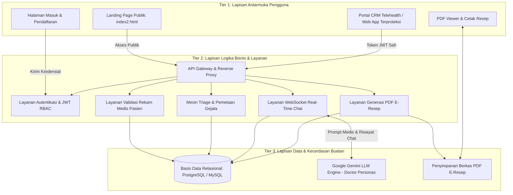
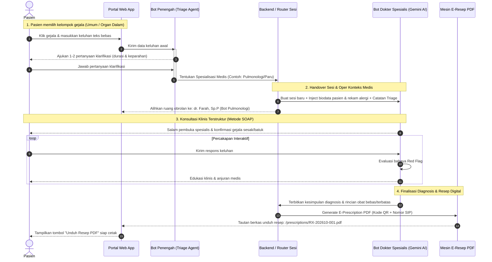

# 🏗️ Dokumen Arsitektur Sistem & Alur Mediasi Dual-Bot
## Proyek: Medicare Consult (Telehealth Platform)
> **Penyusun Utama:** Alpian (Project Leader & Lead System Architect)  
> **Konsultan Kebutuhan:** Maulid & Riski  
> **Modul:** 02 — System Architecture & Triage Logic

---

## 1. 🌐 Arsitektur Sistem Global (Three-Tier Architecture)

Medicare Consult dirancang menggunakan arsitektur modern tiga lapis (*Three-Tier Architecture*) yang memisahkan antara antarmuka pengguna (*Presentation Layer*), logika bisnis aplikasi (*Application/Business Logic Layer*), serta penyimpanan data dan kecerdasan buatan (*Data & AI Layer*).



---

## 2. 🔀 Pemisahan Arsitektur: Landing Page vs. Web App Portal

Salah satu keputusan desain arsitektural terpenting dalam Medicare Consult adalah **pemisahan tegas antara situs publik dengan aplikasi web privat**:

```
+-------------------------------------------------------------+
| 1. SISI PUBLIK (Landing Page)                               |
| File: index2.html                                           |
| Peran: Branding, Showcase Layanan, Testimoni, Pricing       |
| Akses: Siapapun (Bebas)                                     |
+-------------------------------------------------------------+
                             │
            [ Tombol CTA "Log in" / "Sign up" ]
                             │
                             ▼
+-------------------------------------------------------------+
| 2. GERBANG AUTENTIKASI                                      |
| Rute: /auth/login & /auth/register                          |
| Validasi: Email, Password Hash, JWT Token Issue             |
+-------------------------------------------------------------+
                             │
              (Setelah Berhasil Masuk / Login)
                             │
                             ▼
+-------------------------------------------------------------+
| 3. SISI PRIVAT (Aplikasi Utama / Web App Portal)            |
| Rute: /app/dashboard, /app/consultation, /app/prescriptions |
| Desain: Layout CRM Telemedicine (Sidebar, Chat Room, Cards) |
| Proteksi: Middleware Auth Guard (Wajib Login & Lengkap Data)|
+-------------------------------------------------------------+
```

### 2.1 Landing Page Publik (`index2.html`)
- Merupakan aset halaman yang telah ada dengan nuansa visual coral/peach modern, kartu statistik mengambang (*Anna Cooper, Mood Tracking, Appointment Alerts*), dan tombol aksi ganda (*Get Started & Get in touch*).
- Berfungsi untuk optimasi mesin pencari (*SEO*), memperkenalkan keunggulan Medicare Consult kepada publik, menampilkan informasi keamanan medis, serta menjadi titik masuk pendaftaran pengguna baru.
- Tidak memuat fitur konsultasi aktif maupun data pasien sensitif demi keamanan dan privasi medis.

### 2.2 Portal Aplikasi Web Utama (*Telehealth Web App*)
- Halaman mandiri berbasis aplikasi dinamis yang hanya dapat dibuka setelah pengguna mendapatkan sesi login sah (JWT / Session Cookie).
- Memiliki tata letak khusus aplikasi (*Application Shell*): bilah navigasi samping (*sidebar*), indikator status kelengkapan profil medis, ruang chat interaktif, dan panel riwayat resep obat.
- Menjamin bahwa hanya pasien terautentikasi dan terverifikasi yang dapat memanfaatkan kuota konsultasi bot.

---

## 3. 🤖 Arsitektur Mediasi Bot Ganda (*Dual-Bot Pipeline*)

Konsultasi medis online sering kali gagal bila pasien langsung dihadapkan pada dokter spesialis tanpa mengetahui organ tubuh mana yang bermasalah. Medicare Consult memecahkan masalah ini dengan sistem **Dua Tahap Bot (Triage Bot $\to$ Doctor Bot)**:



### 3.1 Tahap 1: Bot Penengah (*Triage Agent*)
- **Tugas Utama**: Berperan sebagai perawat penerima tamu / *triage officer* di IGD rumah sakit.
- **Input yang Diterima**:
  1. Kategori gejala yang diklik pasien (Gejala Umum atau Gejala Organ Dalam).
  2. Keluhan awal dalam teks bebas bahasa sehari-hari.
- **Logika Keputusan**:
  - Mengurai kata kunci keluhan (*Natural Language Processing* sederhana atau LLM prompt pendek).
  - Memeriksa adanya *red flags* (tanda bahaya darurat). Jika ada $\to$ Rujuk ke IGD.
  - Memetakan keluhan ke kode spesialisasi kedokteran yang sesuai:
    - *Batuk berdahak >2 minggu, sesak napas* $\to$ `SP-PULMO` (Spesialis Paru).
    - *Nyeri perut melilit, perih ulu hati, mual* $\to$ `SP-INTERNIST-GI` (Spesialis Penyakit Dalam / Lambung).
    - *Batuk pilek biasa, demam ringan hari ke-2* $\to$ `SP-GEN-MED` (Dokter Umum).
    - *Gatal biduran, ruam kemerahan* $\to$ `SP-DERMA` (Spesialis Kulit).
- **Proses Serah Terima (*Session Handover*)**:
  Bot Penengah merangkum keluhan menjadi berkas JSON *Chief Complaint Summary* dan mengoperkannya ke server aplikasi untuk menugaskan dokter spesialis yang tepat.

### 3.2 Tahap 2: Bot Dokter Spesialis (*Gemini AI Specialist Agent*)
- **Tugas Utama**: Menggantikan peran dokter spesialis dalam melakukan anamnesis terstruktur, menetapkan diagnosis awal, memberikan edukasi gaya hidup, serta meresepkan obat simtomatik yang aman.
- **Injeksi Konteks Awal (*Context Injection*)**:
  Sebelum pesan pertama dikirim ke Gemini AI, sistem secara otomatis menyisipkan *System Prompt* berisi:
  1. Persona dokter (nama, spesialisasi, gaya komunikasi empati dan profesional).
  2. Data rekam medis pasien (Nama, Usia, Berat Badan, Tinggi Badan).
  3. **Data Pantangan Medis (Riwayat Alergi Obat & Penyakit Penyerta)**.
  4. Rangkuman hasil asesmen dari Bot Penengah.
- **Struktur Anamnesis (Metode SOAP)**:
  - **S (*Subjective*)**: Keluhan yang dirasakan pasien, riwayat perjalanan penyakit.
  - **O (*Objective*)**: Data terukur (suhu tubuh perkiraan, usia, berat badan).
  - **A (*Assessment*)**: Diagnosis kerja / dugaan penyakit awal.
  - **P (*Plan*)**: Rencana terapi (obat bebas/terbatas, hidrasi, istirahat cukup, dan kapan harus segera ke rumah sakit jika tidak kunjung membaik).

---

## 4. ⚡ Arsitektur Komunikasi Real-Time (WebSocket vs. REST)

Untuk menciptakan pengalaman percakapan yang mulus seperti aplikasi chatting modern (WhatsApp / Halodoc), sistem mengombinasikan dua protokol jaringan:

| Kebutuhan Aliran Data | Protokol Terpilih | Alasan Teknis |
|---|:---:|---|
| Autentikasi Pengguna & Manajemen Profil | **REST API (HTTPS)** | Bersifat *stateless*, mudah diproteksi dengan header `Authorization: Bearer <token>`, dan terstandar untuk operasi CRUD. |
| Pengambilan Master Gejala & Spesialisasi | **REST API (HTTPS)** | Data jarang berubah, sangat efisien memanfaatkan *caching* peramban web (*browser cache*). |
| Ruang Percakapan Konsultasi (*Live Chat*) | **WebSocket (WSS)** | Komunikasi dua arah *full-duplex* berlatensi rendah. Memungkinkan pengiriman pesan instan, status *"Dokter sedang mengetik..."*, dan serah terima bot secara dinamis. |
| Pengunduhan Berkas E-Resep PDF | **REST API (HTTPS)** | Mengirimkan berkas biner statis (`application/pdf`) dengan *streaming* cepat dan kemampuan *resume download*. |

### 4.1 Siklus Hidup Koneksi WebSocket Sesi Konsultasi

```
1. Client (Web App)                 2. Server (Chat Engine)             3. AI Engine (Gemini)
        │                                     │                                    │
        ├──[ Handshake WebSocket + Token ]───>│                                    │
        │<──[ 101 Switching Protocols ]───────┤                                    │
        │                                     │                                    │
        ├──[ EVENT: client:join_session ]────>│                                    │
        │<──[ EVENT: server:session_ready ]───┤                                    │
        │                                     │                                    │
        ├──[ EVENT: client:send_message ]────>│                                    │
        │<──[ EVENT: server:bot_typing ]──────┤───[ Request Completion API ]──────>│
        │                                     │<──[ Streaming Response ]───────────┤
        │<──[ EVENT: server:bot_message ]─────┤                                    │
        │                                     │                                    │
        ├──[ EVENT: client:end_session ]─────>│                                    │
        │                                     ├───[ Buat Catatan Diagnosis & Resep ]
        │<──[ EVENT: server:rx_ready ]────────┤                                    │
```

---

## 5. 📑 Pipeline Generasi Dokumen E-Resep (PDF Engine)

Ketika sesi konsultasi selesai, sistem tidak hanya menyimpan teks percakapan, melainkan mengaktifkan **Layanan Penerbitan Resep Digital**:

```
[ Data Resep dari Dokter Bot ] 
  - Kode Resep (RX-XXXX)
  - Daftar Obat (Nama, Sediaan, Dosis, Waktu, Aturan)
  - Diagnosa Kerja & Catatan Khusus
  - Rekam Alergi Pasien
              │
              ▼
[ Mesin Templating PDF (Contoh: PDFKit / Puppeteer / jsPDF) ]
  - Menyatukan Kop Surat Resmi Medicare Consult
  - Menghitung Tanggal Kadaluarsa Resep (Berlaku 7 Hari)
  - Mengisi Informasi Dokter Virtual & No. SIP Digital
  - Menghasilkan QR Code Otentikasi (Link Verifikasi Keaslian)
              │
              ▼
[ Berkas Biner PDF Diterbitkan ]
  - Disimpan ke direktori / cloud storage
  - Disematkan ke akun pasien di menu "Riwayat Resep"
  - Link instan diberikan ke pasien di ruang chat
```

Pasien dapat langsung mengklik tombol **"Unduh Resep PDF"**, menyimpan berkas di ponsel mereka, atau mencetaknya menggunakan printer untuk langsung dibawa dan ditebus di apotek terdekat.
