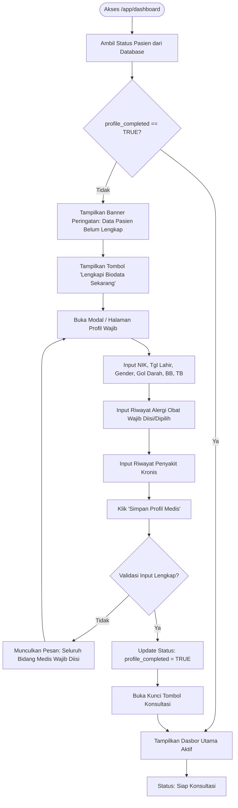
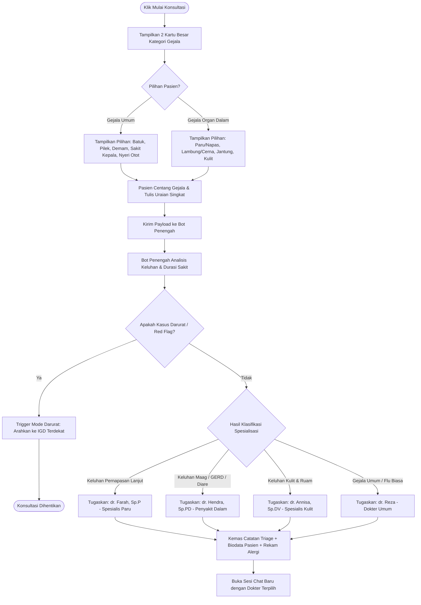
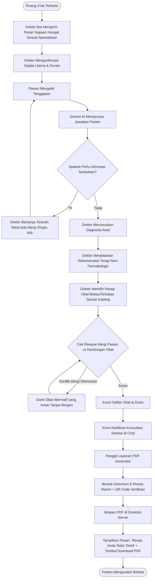

# 🧭 Dokumen Peta Perjalanan Pengguna & Diagram Alir Sistem (Flowchart)
## Proyek: Medicare Consult (Telehealth Platform)
> **Penyusun Utama:** Natun (System Modeler & UML Specialist)  
> **Konsultan Desain:** Riski & Maulid  
> **Modul:** 03 — User Journey & Flowcharts

---

## 1. 🗺️ Peta Perjalanan Pengguna (*User Journey Map*)

Peta perjalanan pengguna memodelkan emosi, kebutuhan mental, dan tindakan pasien (*Patient Persona*) dari saat pertama kali merasakan sakit hingga berhasil memperoleh obat di apotek:

| Tahapan | 1. Timbul Gejala | 2. Akses Landing Page | 3. Registrasi & Biodata | 4. Triage Keluhan | 5. Konsultasi Chat Bot | 6. Resep & Penebusan |
|---|---|---|---|---|---|---|
| **Tujuan Pasien** | Ingin tahu sakit apa dan obat apa yang cepat aman. | Mencari solusi konsultasi cepat tanpa antre. | Membuat akun dan melengkapi profil kesehatan. | Memilih gejala yang dirasakan di tubuhnya. | Berdialog dengan dokter dan mendengarkan saran. | Mendapatkan resep obat dan membeli di apotek terdekat. |
| **Titik Sentuh (*Touchpoint*)** | Gejala fisik (batuk, demam, sesak). | `index2.html` (Landing Page Medicare). | Formulir Register & Form Wajib Biodata Pasien. | Layar Pemilih Gejala & Bot Penengah. | Ruang Chatting Web App (Dokter Spesialis AI). | Dokumen PDF E-Resep ber-QR Code & Apotek Fisik. |
| **Kondisi Emosi** | 😰 Cemas & gelisah | 😌 Lega melihat platform terpercaya | 😐 Agak lelah mengisi data (namun paham tujuannya) | 💡 Terbantu dengan pilihan gejala intuitif | 😊 Nyaman dan didengarkan secara berempati | 😃 Puas memegang resep resmi siap cetak |
| **Pain Point Potensial** | Takut penyakitnya parah jika googling sembarangan. | Bingung apakah ada dokter spesialis yang cocok. | Malas mengisi form jika terlalu berbelit-belit. | Tidak tahu istilah medis dari penyakit organ dalamnya. | Takut bot memberi jawaban kaku dan tidak nyambung. | Apotek menolak resep jika formatnya tidak resmi. |
| **Solusi Medicare Consult** | Sediakan konsultasi daring instan 24/7. | Tampilan bersih, profesional, dan tombol CTA jelas. | Simpan biodata sekali untuk seumur hidup. | Kategorisasi mudah: Gejala Umum vs Organ Dalam. | Prompt Gemini AI yang hangat, empati, dan klinis. | PDF resmi ber-Kop Surat, No. SIP, dan QR Code. |

---

## 2. 🔄 Flowchart Global End-to-End Sistem

Diagram alir komprehensif berikut menggambarkan perjalanan data dan keputusan dari awal pengguna membuka peramban web hingga selesai konsultasi:

```mermaid
flowchart TD
    Start([Mulai: Pasien Buka Website]) --> LP[Buka Landing Page: index2.html]
    LP --> PilihanAuth{Sudah Punya Akun?}

    PilihanAuth -- Belum --> Register[Halaman Registrasi: Buat Akun Baru]
    Register --> Login[Halaman Login: Masukkan Kredensial]
    PilihanAuth -- Sudah --> Login

    Login --> ValidasiLogin{Kredensial Valid?}
    ValidasiLogin -- Tidak --> NotifGagal[Tampilkan Pesan Galat] --> Login
    ValidasiLogin -- Ya --> SetToken[Generate Token Sesi / JWT]

    SetToken --> MasukPortal[Alihkan ke Portal Web App: /app/dashboard]
    MasukPortal --> CekProfil{Apakah Profil Pasien Lengkap 100%?}

    CekProfil -- Belum --> LockFitur[Kunci Akses Konsultasi]
    LockFitur --> IsiBiodata[Halaman Form Rekam Medis Wajib: NIK, Tgl Lahir, Alergi, BB/TB]
    IsiBiodata --> SimpanBiodata[Simpan Biodata ke Database]
    SimpanBiodata --> CekProfil

    CekProfil -- Sudah --> BukaKonsultasi[Aktifkan Tombol 'Mulai Konsultasi Baru']
    BukaKonsultasi --> PilihKategori[Pilih Kategori Gejala: Gejala Umum vs Organ Dalam]

    PilihKategori --> InputKeluhan[Pilih Sub-Gejala & Ketik Keluhan Detail Pasien]
    InputKeluhan --> TriageStart[Aktifkan Bot Penengah: Triage Agent]

    TriageStart --> CekRedFlag{Apakah Ada Tanda Bahaya / Red Flags?}
    CekRedFlag -- Ya --> EmergencyAlert[Hentikan Alur Chat! Tampilkan Rujukan Darurat ke IGD + Telp 119] --> EndDarurat([Selesai: Pasien ke Rumah Sakit])

    CekRedFlag -- Tidak --> TriageDecision[Bot Penengah Menentukan Spesialisasi Medis yang Tepat]
    TriageDecision --> HandoverBot[Handover Sesi: Sambungkan ke Bot Dokter Spesialis]

    HandoverBot --> LiveChatRoom[Masuk Ruang Chat Real-time WebSocket]
    LiveChatRoom --> Anamnesis[Bot Dokter Melakukan Anamnesis Terstruktur: Metode SOAP]
    Anamnesis --> PasienTanyaJawab[Pasien & Dokter Saling Bertukar Pesan]
    PasienTanyaJawab --> CukupData{Data Anamnesis Sudah Memadai?}
    CukupData -- Belum --> PasienTanyaJawab

    CukupData -- Ya --> BuatDiagnosis[Bot Dokter Menetapkan Diagnosis Awal & Anjuran Non-Obat]
    BuatDiagnosis --> BuatResep[Bot Dokter Merumuskan Resep Obat Bebas/Terbatas]
    BuatResep --> SimpanSesi[Simpan Riwayat Konsultasi & Resep ke Basis Data]

    SimpanSesi --> CetakPDF[Layanan PDF Engine Menerbitkan Dokumen E-Resep PDF]
    CetakPDF --> TampilkanDownload[Munculkan Tombol 'Unduh E-Resep PDF' di Ruang Chat]
    TampilkanDownload --> PasienDownload[Pasien Mengunduh Berkas PDF Resmi]
    PasienDownload --> TebusApotek[Pasien Cetak / Bawa PDF ke Apotek Terdekat]
    TebusApotek --> Selesai([Selesai: Pasien Mendapatkan Obat])
```

---

## 3. 🧩 Flowchart Detail Per Sub-Proses

### 3.1 Flowchart Sub-Proses 1: Autentikasi & Gatekeeping Profil Pasien
Alur ini memastikan integritas rekam medis pasien sebelum sistem mengizinkan pengambilan keputusan klinis:

### 3.2 Flowchart Sub-Proses 2: Triage Gejala & Pengalihan Dokter Spesialis
Alur pemilihan keluhan terstruktur yang membagi beban kerja antara Bot Penengah dan Bot Dokter Spesialis:

### 3.3 Flowchart Sub-Proses 3: Konsultasi Interaktif & Generasi E-Resep PDF
Alur percakapan mendalam hingga penerbitan resep digital:

---

## 4. 🖨️ Instruksi Konversi ke Format Draw.io

Seluruh diagram alir di atas telah dikonfigurasi menggunakan standar notasi aliran proses (BPMN / flowchart standar). Untuk kebutuhan laporan resmi dan presentasi tugas kuliah:
1. Kode diagram di atas dapat langsung disalin ke situs **[draw.io](https://app.diagrams.net)** melalui menu: `Arrange` $\to$ `Insert` $\to$ `Advanced` $\to$ `Mermaid`.
2. Selain itu, Kelompok 2 telah menyediakan berkas biner/XML siap pakai yaitu **[`medicare_consult_diagrams.drawio`](./medicare_consult_diagrams.drawio)** yang memuat tab khusus flowchart beresolusi tinggi dengan tata letak visual siap ekspor PNG/PDF.
