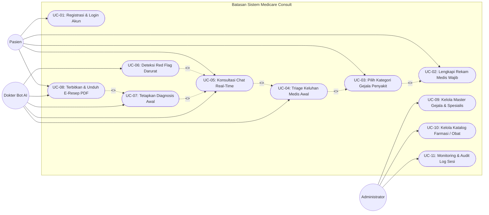
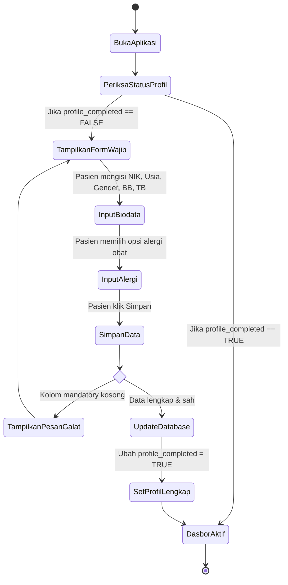
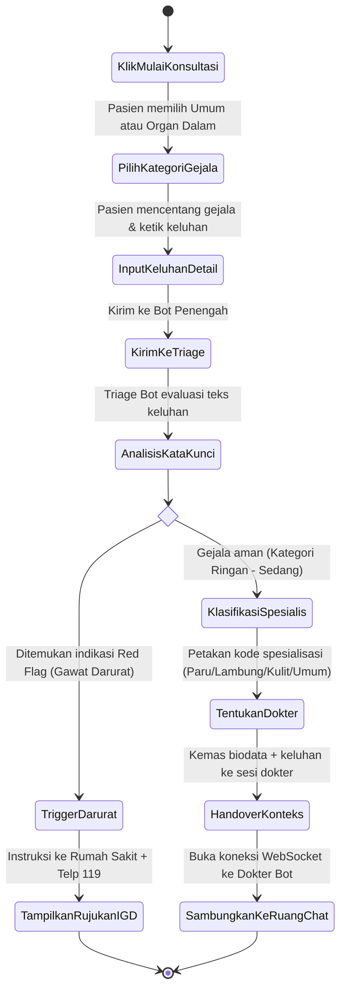
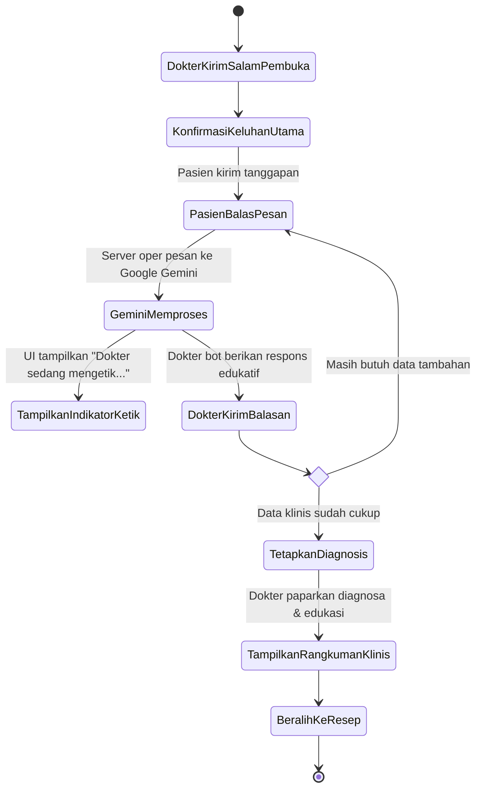
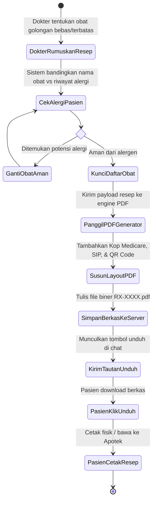

# 📐 Dokumen Pemodelan UML: Use Case & Activity Diagrams
## Proyek: Medicare Consult (Telehealth Platform)
> **Penyusun Utama:** Natun (System Modeler & UML Specialist)  
> **Konsultan Bisnis:** Maulid (Lead Business Analyst)  
> **Modul:** 04 — Use Case & Activity Diagrams

---

## 1. 👥 Diagram Use Case Sistem (Use Case Diagram)

Diagram Use Case berikut memodelkan fungsionalitas sistem yang berinteraksi dengan tiga aktor utama: **Pasien**, **Dokter Virtual (AI Persona)**, dan **Administrator Sistem**.

---

## 2. 📋 Tabel Spesifikasi Skenario Use Case

### 2.1 Skenario UC-02: Lengkapi Rekam Medis Wajib Pasien (*Profile Gatekeeping*)

| Elemen Skenario | Deskripsi Rinci |
|---|---|
| **Use Case ID** | **UC-02** |
| **Nama Use Case** | Lengkapi Rekam Medis Wajib Pasien (*Patient Profile Gatekeeping*) |
| **Aktor Utama** | Pasien |
| **Deskripsi Singkat** | Pasien mengisi biodata medis esensial (NIK, tanggal lahir, jenis kelamin, golongan darah, tinggi/berat badan, alergi obat, dan penyakit bawaan) sebagai syarat mutlak sebelum dapat mengakses layanan konsultasi. |
| **Prekondisi** | Pasien telah berhasil masuk (*login*) ke dalam portal Web App Medicare Consult. |
| **Postkondisi** | Status pasien diperbarui menjadi `profile_completed = TRUE` dan tombol "Mulai Konsultasi" aktif. |
| **Alur Normal (*Main Flow*)** | 1. Pasien membuka halaman profil medis atau diarahkan otomatis dari dasbor utama. 2. Sistem menampilkan formulir data diri dan kuesioner medis wajib. 3. Pasien memasukkan NIK, tanggal lahir, jenis kelamin, dan golongan darah. 4. Pasien memasukkan berat badan (kg) dan tinggi badan (cm). 5. Pasien memilih opsi riwayat alergi obat (atau mencentang *"Tidak Memiliki Riwayat Alergi"*). 6. Pasien memilih atau mengosongkan riwayat penyakit kronis bawaan. 7. Pasien menekan tombol *"Simpan Profil Medis"*. 8. Sistem memvalidasi kelengkapan semua bidang mandatory. 9. Sistem menyimpan data ke tabel `patients`. 10. Sistem menampilkan notifikasi sukses dan mengaktifkan fitur konsultasi. |
| **Alur Alternatif (*Alternative Flow*)** | **8a. Bidang Wajib Belum Terisi Lengkap:** 1. Sistem mendeteksi adanya kolom penting yang kosong (misal: belum memilih opsi alergi obat). 2. Sistem menolak penyimpanan dan menandai kolom yang belum diisi dengan warna merah. 3. Sistem menampilkan instruksi: *"Seluruh data medis wajib dilengkapi demi keselamatan konsultasi klinis."* 4. Pasien melengkapi data dan menekan tombol simpan kembali (kembali ke langkah 7). |

---

### 2.2 Skenario UC-04: Triage Keluhan Medis Awal oleh Bot Penengah

| Elemen Skenario | Deskripsi Rinci |
|---|---|
| **Use Case ID** | **UC-04** |
| **Nama Use Case** | Triage Keluhan Medis Awal (*Symptom Triage & Specialist Routing*) |
| **Aktor Utama** | Pasien, Bot Penengah (*Triage Agent*) |
| **Deskripsi Singkat** | Bot Penengah menganalisis keluhan yang dipilih dan diketik oleh pasien untuk menentukan apakah kasus bersifat darurat atau dapat diteruskan ke dokter spesialis tertentu. |
| **Prekondisi** | Pasien berstatus `profile_completed = TRUE` dan telah memilih kategori gejala (Umum atau Organ Dalam). |
| **Postkondisi** | Spesialisasi dokter terpilih dan sesi obrolan dialihkan ke persona dokter spesialis yang relevan. |
| **Alur Normal (*Main Flow*)** | 1. Pasien memilih sub-gejala yang tersedia dan mengetikkan uraian keluhan tambahan. 2. Pasien menekan tombol *"Kirim Keluhan ke Bot Penengah"*. 3. Bot Penengah membaca keluhan dan mengajukan 1-2 pertanyaan klarifikasi terkait durasi gejala dan tingkat keparahan. 4. Pasien merespons pertanyaan klarifikasi. 5. Bot Penengah mengevaluasi aturan pemetaan spesialisasi. 6. Bot Penengah menyimpulkan bahwa pasien memerlukan penanganan Dokter Spesialis (misal: Spesialis Pulmonologi untuk keluhan batuk sesak). 7. Bot Penengah menginformasikan kepada pasien bahwa sesi akan dialihkan ke dokter spesialis terkait. 8. Sistem melakukan serah terima (*session handover*) ke ruang chat dokter spesialis. |
| **Alur Alternatif (*Alternative Flow*)** | **5a. Deteksi Gejala Kegawatdaruratan (*Red Flags*):** 1. Bot Penengah mendeteksi kata kunci bahaya (misal: sesak napas berat, nyeri dada tembus ke punggung, batuk darah). 2. Bot Penengah menghentikan proses perujukan biasa. 3. Sistem memunculkan jendela darurat: *"Peringatan Medis: Gejala Anda memerlukan penanganan darurat segera!"* 4. Sistem menyertakan panduan pertolongan pertama dan kontak IGD terdekat / ambulans 119. 5. Konsultasi bot dibatalkan secara aman demi keselamatan pasien. |

---

### 2.3 Skenario UC-05: Konsultasi Chat Real-Time dengan Dokter Bot Gemini

| Elemen Skenario | Deskripsi Rinci |
|---|---|
| **Use Case ID** | **UC-05** |
| **Nama Use Case** | Konsultasi Chat Real-Time (*Interactive Teleconsultation*) |
| **Aktor Utama** | Pasien, Dokter Bot Spesialis (*Gemini AI Engine*) |
| **Deskripsi Singkat** | Pasien dan Dokter Bot berdialog secara interaktif melalui koneksi WebSocket untuk melakukan tanya-jawab klinis (anamnesis) hingga dokter menyimpulkan masalah kesehatan pasien. |
| **Prekondisi** | Handover dari Bot Penengah berhasil dan ruang obrolan WebSocket telah terhubung. |
| **Postkondisi** | Percakapan selesai, diagnosis kerja ditetapkan, dan sesi siap menerbitkan resep obat. |
| **Alur Normal (*Main Flow*)** | 1. Dokter Bot menyapa pasien dengan ramah dan menyebutkan rangkuman keluhan awal yang diterima dari Bot Penengah. 2. Dokter Bot mengajukan pertanyaan terstruktur (faktor pencetus, riwayat konsumsi makanan/obat sebelumnya). 3. Pasien membalas pertanyaan dokter melalui kotak input pesan. 4. Sistem menampilkan indikator *"Dokter sedang mengetik..."* saat AI memproses jawaban. 5. Dokter Bot memberikan penjelasan mengenai mekanisme tubuh dan anjuran non-farmakologis (istirahat, asupan cairan, kompres hangat, dsb.). 6. Dokter Bot mengonfirmasi apakah pasien memiliki pertanyaan tambahan. 7. Pasien menyatakan telah memahami penjelasan dokter. 8. Dokter Bot menutup sesi konsultasi dan mengaktifkan pembuatan resep. |
| **Alur Alternatif (*Alternative Flow*)** | **3a. Koneksi Internet Pasien Terputus:** 1. Sesi WebSocket mendeteksi putusnya sambungan jaringan (*socket disconnect*). 2. Sistem menampilkan banner: *"Koneksi terputus. Mencoba menghubungkan kembali..."* 3. Riwayat pesan tersimpan aman di database lokal. 4. Saat koneksi pulih, sistem menyinkronkan pesan terakhir tanpa kehilangan progres anamnesis. |

---

### 2.4 Skenario UC-08: Terbitkan & Unduh E-Resep PDF Resmi

| Elemen Skenario | Deskripsi Rinci |
|---|---|
| **Use Case ID** | **UC-08** |
| **Nama Use Case** | Terbitkan & Unduh E-Resep PDF Resmi (*E-Prescription Issuance & Download*) |
| **Aktor Utama** | Pasien, Dokter Bot AI |
| **Deskripsi Singkat** | Sistem menyusun formulir resep digital resmi berdasarkan saran obat bebas/terbatas dari dokter bot, menghasilkan berkas PDF ber-QR Code, dan menyediakannya untuk diunduh pasien. |
| **Prekondisi** | Konsultasi telah selesai (UC-05) dan diagnosis kerja telah terbentuk (UC-07). |
| **Postkondisi** | Berkas PDF E-Resep tersimpan di server dan terunduh ke perangkat lokal pasien. |
| **Alur Normal (*Main Flow*)** | 1. Dokter Bot mengirimkan payload resep obat (nama obat, dosis, sediaan, waktu minum, aturan sebelum/sesudah makan). 2. Sistem memverifikasi kembali bahwa tidak ada obat yang memicu alergi pasien. 3. Mesin PDF Generator menyusun layout dokumen resmi dengan kop surat Medicare Consult, nomor SIP dokter virtual, dan QR Code verifikasi. 4. Berkas PDF disimpan di penyimpanan server dengan penamaan unik (contoh: `RX-202610-001.pdf`). 5. Ruang chat menampilkan kartu resep dengan tombol *"Unduh E-Resep PDF"*. 6. Pasien mengklik tombol unduh. 7. Beramban pasien mengunduh berkas PDF siap cetak. 8. Pasien dapat membawa resep cetak ke apotek terdekat untuk ditebus. |

---

## 3. 🏃 Diagram Aktivitas (Activity Diagrams)

### 3.1 Activity Diagram 1: Onboarding Pasien & Gatekeeper Rekam Medis

---

### 3.2 Activity Diagram 2: Triage Gejala & Penugasan Dokter Spesialis

---

### 3.3 Activity Diagram 3: Konsultasi Interaktif & Analisis Klinis (Metode SOAP)

---

### 3.4 Activity Diagram 4: Penerbitan Resep Obat Digital & Cetak PDF

