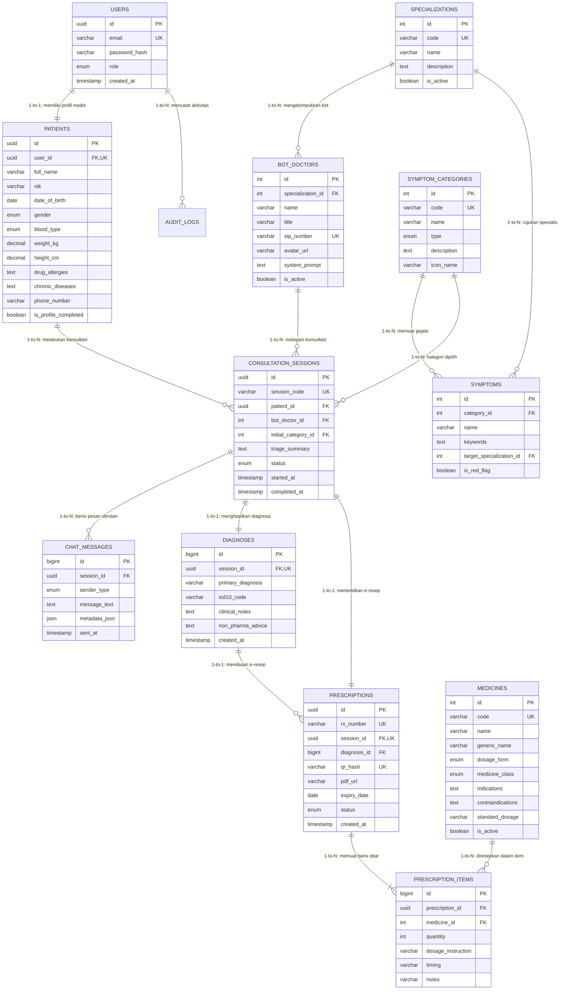

# 💾 Dokumen Perancangan Basis Data: Normalisasi & ERD
## Proyek: Medicare Consult (Telehealth Platform)
> **Penyusun Utama:** Sultan (Database Administrator & Data Modeler)  
> **Konsultan Arsitektur:** Alpian (System Architect)  
> **Modul:** 05 — Database Design, ERD, & Normalization

---

## 1. 🧮 Proses Normalisasi Data (Tahapan Akademis)

Untuk menjamin efisiensi penyimpanan, integritas referensial, serta mencegah anomali insersi (*insertion anomaly*), anomali pembaruan (*update anomaly*), dan anomali penghapusan (*deletion anomaly*), perancangan basis data Medicare Consult melalui proses normalisasi formal dari bentuk tidak ternormalisasi (UNF) hingga bentuk normal ketiga (3NF).

---

### 1.1 Bentuk Tidak Ternormalisasi (*Unnormalized Form* / UNF)
Pada bentuk mentah awal, seluruh data transaksi rekam medis dan konsultasi dicatat ke dalam satu lembar data tunggal yang memuat kolom majemuk dan grup berulang (*repeating groups*):

```
UNF_KONSULTASI_MEDIS:
(NoKonsultasi, TglKonsultasi, EmailPasien, Password, NamaPasien, NIK, TglLahir, Gender, GolDarah, 
 BeratBadan, TinggiBadan, RiwayatAlergi, PenyakitBawaan, KategoriGejala, KeluhanPasien, 
 NamaDokterBot, NoSIPDokter, SpesialisasiDokter, DiagnosaKlinis, AnjuranNonObat, 
 {PesanChat: WaktuKirim, Pengirim, IsiPesan}, 
 {Obat: KodeObat, NamaObat, GolonganObat, BentukSediaan, Dosis, WaktuMinum, AturanPakai}, 
 NoResepPDF, TglKadaluarsaResep, QRCodeHash)
```
- **Kelemahan UNF**: Terjadi perulangan masif data pasien di setiap sesi konsultasi, data obat dan riwayat chat berbentuk himpunan jamak dalam satu baris (*multivalued attributes*), serta risiko inkonsistensi data dokter virtual.

---

### 1.2 Bentuk Normal Pertama (1NF)
> **Kaidah 1NF**: Menghilangkan atribut bernilai jamak (*multivalued attributes*) dan *repeating groups*. Setiap atribut dalam tabel harus bernilai tunggal/atomik (*atomic value*), serta memiliki *primary key* yang unik.

Pada tahap 1NF, grup berulang (pesan chat dan daftar obat dalam resep) dipecah menjadi entitas terpisah dengan menyertakan kunci relasional:

1. **`1NF_PASIEN`** (`user_id`, `email`, `password_hash`, `nama_pasien`, `nik`, `tgl_lahir`, `gender`, `gol_darah`, `berat_badan`, `tinggi_badan`, `riwayat_alergi`, `penyakit_bawaan`, `is_profile_completed`)
2. **`1NF_DOKTER_BOT`** (`bot_id`, `nama_dokter`, `no_sip`, `spesialisasi`, `system_prompt`)
3. **`1NF_SESI_KONSULTASI`** (`session_id`, `session_code`, `patient_id`, `bot_id`, `kategori_gejala`, `keluhan_awal`, `diagnosa_klinis`, `anjuran`, `tgl_konsultasi`, `status`)
4. **`1NF_PESAN_CHAT`** (`message_id`, `session_id`, `sender_type`, `pesan_teks`, `waktu_kirim`)
5. **`1NF_RESEP_OBAT`** (`rx_id`, `session_id`, `no_resep`, `tgl_terbit`, `tgl_kadaluarsa`, `qr_hash`, `file_pdf`)
6. **`1NF_DETAIL_OBAT_RESEP`** (`rx_id`, `kode_obat`, `nama_obat`, `golongan_obat`, `sediaan`, `dosis`, `aturan_pakai`)

- **Evaluasi 1NF**: Seluruh atribut telah atomik. Namun, masih terdapat ketergantungan fungsional parsial (*partial dependency*) pada tabel master dan detail.

---

### 1.3 Bentuk Normal Kedua (2NF)
> **Kaidah 2NF**: Memenuhi syarat 1NF, dan tidak boleh ada atribut non-kunci yang memiliki ketergantungan parsial (*partial functional dependency*) terhadap *primary key* komposit. Setiap atribut non-kunci harus bergantung sepenuhnya (*full functional dependency*) pada keseluruhan *primary key*.

Pada tahap 2NF:
- Data master obat dipisahkan dari detail resep agar atribut `nama_obat`, `golongan_obat`, dan `sediaan` tidak bergantung parsial pada `(rx_id, kode_obat)`.
- Data kategori gejala dan spesialisasi dipisahkan dari sesi konsultasi.

Tabel hasil 2NF:
- `USERS` (Akun otentikasi independen)
- `PATIENTS` (Profil medis pasien yang merujuk ke `user_id`)
- `BOT_DOCTORS` (Profil dokter bot)
- `SPECIALIZATIONS` (Master spesialisasi kedokteran)
- `SYMPTOMS` (Master gejala penyakit)
- `CONSULTATION_SESSIONS` (Transaksi sesi konsultasi)
- `CHAT_MESSAGES` (Pesan obrolan real-time)
- `MEDICINES` (Master katalog farmasi)
- `PRESCRIPTIONS` (Header resep digital)
- `PRESCRIPTION_ITEMS` (Baris obat per resep dengan ketergantungan penuh pada `id`)

---

### 1.4 Bentuk Normal Ketiga (3NF)
> **Kaidah 3NF**: Memenuhi syarat 2NF, dan tidak boleh ada ketergantungan transitif (*transitive functional dependency*). Atribut non-kunci tidak boleh bergantung pada atribut non-kunci lainnya ($X \to Y$ dan $Y \to Z$).

Pada tahap 3NF, dilakukan eliminasi ketergantungan tidak langsung:
1. Pada tabel `BOT_DOCTORS`: Sebelumnya nama spesialisasi bergantung pada `specialization_id`. Di 3NF, dokter hanya menyimpan `specialization_id` sebagai *foreign key* yang merujuk ke tabel `SPECIALIZATIONS`.
2. Pada tabel `SYMPTOMS`: Gejala dipisahkan ke dalam `SYMPTOM_CATEGORIES` (Gejala Umum vs Organ Dalam) sehingga jenis kategori tidak transitif.
3. Pada tabel `PRESCRIPTIONS`: Diagnosis klinis dipisahkan ke dalam tabel `DIAGNOSES` tersendiri agar dapat memuat kode standar medis ICD-10 dan catatan SOAP tanpa menduplikasi data resep.

Hasil akhir 3NF merupakan skema basis data relasional yang kokoh, terhindar dari redundansi, dan siap diimplementasikan secara fisik.

---

## 2. 📖 Kamus Data (*Data Dictionary*)

Berikut adalah definisi kamus data fisik untuk seluruh tabel sistem Medicare Consult:

### 2.1 Tabel `users` (Akun Autentikasi Pengguna)
| Nama Kolom | Tipe Data | Batasan (*Constraints*) | Keterangan |
|---|---|---|---|
| `id` | `UUID` / `BIGINT` | PRIMARY KEY, AUTO_INCREMENT | Pengenal unik akun pengguna |
| `email` | `VARCHAR(150)` | NOT NULL, UNIQUE | Alamat email aktif untuk login |
| `password_hash` | `VARCHAR(255)` | NOT NULL | Hash kata sandi terenkripsi (Bcrypt) |
| `role` | `ENUM('PATIENT','ADMIN')` | NOT NULL, DEFAULT 'PATIENT' | Peran otorisasi sistem |
| `created_at` | `TIMESTAMP` | NOT NULL, DEFAULT CURRENT_TIMESTAMP | Waktu pendaftaran akun |
| `updated_at` | `TIMESTAMP` | NOT NULL, DEFAULT CURRENT_TIMESTAMP | Waktu pembaruan data akun |

### 2.2 Tabel `patients` (Profil & Rekam Medis Wajib Pasien)
| Nama Kolom | Tipe Data | Batasan (*Constraints*) | Keterangan |
|---|---|---|---|
| `id` | `UUID` / `BIGINT` | PRIMARY KEY, AUTO_INCREMENT | Pengenal unik data pasien |
| `user_id` | `UUID` / `BIGINT` | NOT NULL, UNIQUE, FK -> users(id) | Relasi 1-to-1 dengan akun user |
| `full_name` | `VARCHAR(150)` | NOT NULL | Nama lengkap pasien sesuai KTP |
| `nik` | `VARCHAR(16)` | NULLABLE | Nomor Induk Kependudukan (16 digit) |
| `date_of_birth` | `DATE` | NOT NULL | Tanggal lahir untuk perhitungan umur |
| `gender` | `ENUM('MALE','FEMALE')` | NOT NULL | Jenis kelamin pasien |
| `blood_type` | `ENUM('A','B','AB','O','UNKNOWN')` | NOT NULL, DEFAULT 'UNKNOWN' | Golongan darah pasien |
| `weight_kg` | `DECIMAL(5,2)` | NOT NULL | Berat badan dalam kilogram (untuk dosis) |
| `height_cm` | `DECIMAL(5,2)` | NOT NULL | Tinggi badan dalam sentimeter |
| `drug_allergies` | `TEXT` | NOT NULL | Riwayat alergi obat (atau 'TIDAK ADA') |
| `chronic_diseases` | `TEXT` | NULLABLE | Riwayat penyakit bawaan/kronis |
| `phone_number` | `VARCHAR(20)` | NOT NULL | Nomor WhatsApp / Telepon aktif |
| `is_profile_completed` | `BOOLEAN` | NOT NULL, DEFAULT FALSE | Penanda gatekeeper kelengkapan data |
| `updated_at` | `TIMESTAMP` | NOT NULL, DEFAULT CURRENT_TIMESTAMP | Waktu pembaruan profil rekam medis |

### 2.3 Tabel `specializations` (Data Master Spesialisasi Medis)
| Nama Kolom | Tipe Data | Batasan (*Constraints*) | Keterangan |
|---|---|---|---|
| `id` | `INT` | PRIMARY KEY, AUTO_INCREMENT | Pengenal unik spesialisasi |
| `code` | `VARCHAR(20)` | NOT NULL, UNIQUE | Kode unik (contoh: `SP-PULMO`, `SP-GEN`) |
| `name` | `VARCHAR(100)` | NOT NULL | Nama bidang (Spesialis Paru, Dokter Umum) |
| `description` | `TEXT` | NULLABLE | Deskripsi cakupan organ & penyakit |
| `is_active` | `BOOLEAN` | NOT NULL, DEFAULT TRUE | Status ketersediaan rujukan |

### 2.4 Tabel `bot_doctors` (Data Persona Dokter Virtual AI)
| Nama Kolom | Tipe Data | Batasan (*Constraints*) | Keterangan |
|---|---|---|---|
| `id` | `INT` | PRIMARY KEY, AUTO_INCREMENT | Pengenal unik dokter virtual |
| `specialization_id` | `INT` | NOT NULL, FK -> specializations(id) | Relasi ke bidang spesialisasi |
| `name` | `VARCHAR(120)` | NOT NULL | Nama dokter (contoh: dr. Farah Sp.P) |
| `title` | `VARCHAR(50)` | NOT NULL | Gelar medis virtual |
| `sip_number` | `VARCHAR(50)` | NOT NULL, UNIQUE | Nomor Izin Praktik digital virtual |
| `avatar_url` | `VARCHAR(255)` | NULLABLE | URL foto profil avatar dokter bot |
| `system_prompt` | `TEXT` | NOT NULL | Instruksi persona & pedoman Gemini AI |
| `is_active` | `BOOLEAN` | NOT NULL, DEFAULT TRUE | Status operasional bot |

### 2.5 Tabel `symptom_categories` (Kategori Gejala Penyakit)
| Nama Kolom | Tipe Data | Batasan (*Constraints*) | Keterangan |
|---|---|---|---|
| `id` | `INT` | PRIMARY KEY, AUTO_INCREMENT | Pengenal unik kategori |
| `code` | `VARCHAR(20)` | NOT NULL, UNIQUE | Kode (`CAT-GENERAL`, `CAT-ORGAN`) |
| `name` | `VARCHAR(100)` | NOT NULL | Nama kategori (Gejala Umum / Organ Dalam) |
| `type` | `ENUM('GENERAL','ORGAN_SPECIFIC')` | NOT NULL | Klasifikasi jenis pengelompokan |
| `description` | `TEXT` | NULLABLE | Panduan pemilihan bagi pasien |
| `icon_name` | `VARCHAR(50)` | NULLABLE | Nama ikon visual (Lucide icon) |

### 2.6 Tabel `symptoms` (Master Gejala Spesifik)
| Nama Kolom | Tipe Data | Batasan (*Constraints*) | Keterangan |
|---|---|---|---|
| `id` | `INT` | PRIMARY KEY, AUTO_INCREMENT | Pengenal unik gejala |
| `category_id` | `INT` | NOT NULL, FK -> symptom_categories(id) | Relasi ke kategori induk |
| `name` | `VARCHAR(120)` | NOT NULL | Nama gejala (Batuk Berdahak, Sesak Napas) |
| `keywords` | `TEXT` | NOT NULL | Kata kunci pencarian NLP untuk triage bot |
| `target_specialization_id` | `INT` | NOT NULL, FK -> specializations(id) | Spesialisasi default rujukan |
| `is_red_flag` | `BOOLEAN` | NOT NULL, DEFAULT FALSE | Indikator bahaya kegawatdaruratan |

### 2.7 Tabel `consultation_sessions` (Sesi Konsultasi Aktif/Riwayat)
| Nama Kolom | Tipe Data | Batasan (*Constraints*) | Keterangan |
|---|---|---|---|
| `id` | `UUID` / `BIGINT` | PRIMARY KEY, AUTO_INCREMENT | Pengenal unik sesi konsultasi |
| `session_code` | `VARCHAR(30)` | NOT NULL, UNIQUE | Nomor rujukan unik (MC-YYYYMMDD-XXXX) |
| `patient_id` | `UUID` / `BIGINT` | NOT NULL, FK -> patients(id) | Pasien yang berkonsultasi |
| `bot_doctor_id` | `INT` | NULLABLE, FK -> bot_doctors(id) | Dokter bot yang menangani |
| `initial_category_id` | `INT` | NOT NULL, FK -> symptom_categories(id)| Kategori gejala awal yang dipilih |
| `triage_summary` | `TEXT` | NULLABLE | Catatan keluhan dari Bot Penengah |
| `status` | `ENUM('IN_TRIAGE','IN_CHAT','COMPLETED','EMERGENCY_REFERRED','CANCELLED')` | NOT NULL | Status siklus konsultasi |
| `started_at` | `TIMESTAMP` | NOT NULL, DEFAULT CURRENT_TIMESTAMP | Waktu sesi dimulai |
| `completed_at` | `TIMESTAMP` | NULLABLE | Waktu sesi resmi ditutup |

### 2.8 Tabel `chat_messages` (Pesan Obrolan Sesi Konsultasi)
| Nama Kolom | Tipe Data | Batasan (*Constraints*) | Keterangan |
|---|---|---|---|
| `id` | `BIGINT` | PRIMARY KEY, AUTO_INCREMENT | Pengenal unik pesan |
| `session_id` | `UUID` / `BIGINT` | NOT NULL, FK -> consultation_sessions(id) | Relasi ke sesi obrolan aktif |
| `sender_type` | `ENUM('PATIENT','TRIAGE_BOT','DOCTOR_BOT','SYSTEM')` | NOT NULL | Entitas pengirim pesan |
| `message_text` | `TEXT` | NOT NULL | Isi teks percakapan |
| `metadata_json` | `JSON` / `TEXT` | NULLABLE | Payload ekstra (indikator kartu, resep) |
| `sent_at` | `TIMESTAMP` | NOT NULL, DEFAULT CURRENT_TIMESTAMP | Waktu pengiriman pesan |

### 2.9 Tabel `diagnoses` (Catatan Diagnosis Klinis)
| Nama Kolom | Tipe Data | Batasan (*Constraints*) | Keterangan |
|---|---|---|---|
| `id` | `BIGINT` | PRIMARY KEY, AUTO_INCREMENT | Pengenal unik catatan diagnosis |
| `session_id` | `UUID` / `BIGINT` | NOT NULL, UNIQUE, FK -> consultation_sessions(id) | Relasi 1-to-1 dengan sesi selesai |
| `primary_diagnosis` | `VARCHAR(200)` | NOT NULL | Diagnosis kerja awal (misal: Faringitis Akut) |
| `icd10_code` | `VARCHAR(10)` | NULLABLE | Kode standar penyakit ICD-10 (misal: J02.9) |
| `clinical_notes` | `TEXT` | NOT NULL | Catatan anamnesis metode SOAP ringkas |
| `non_pharma_advice` | `TEXT` | NOT NULL | Anjuran istirahat, pola makan, dan hidrasi |
| `created_at` | `TIMESTAMP` | NOT NULL, DEFAULT CURRENT_TIMESTAMP | Waktu penetapan diagnosis |

### 2.10 Tabel `medicines` (Katalog Farmasi & Obat Bebas/Terbatas)
| Nama Kolom | Tipe Data | Batasan (*Constraints*) | Keterangan |
|---|---|---|---|
| `id` | `INT` | PRIMARY KEY, AUTO_INCREMENT | Pengenal unik obat |
| `code` | `VARCHAR(30)` | NOT NULL, UNIQUE | Kode obat (contoh: `MED-PCT-500`) |
| `name` | `VARCHAR(150)` | NOT NULL | Nama dagang / sediaan obat |
| `generic_name` | `VARCHAR(150)` | NOT NULL | Nama kandungan generik (Paracetamol) |
| `dosage_form` | `ENUM('TABLET','KAPSUL','SIRUP','SALEP','DROP')` | NOT NULL | Bentuk sediaan farmasi |
| `medicine_class` | `ENUM('BEBAS_HIJAU','BEBAS_TERBATAS_BIRU','SUPLEMEN')` | NOT NULL | Batasan golongan hukum obat |
| `indications` | `TEXT` | NOT NULL | Khasiat atau indikasi pengobatan |
| `contraindications` | `TEXT` | NOT NULL | Pantangan pasien (misal: gagal hati akut) |
| `standard_dosage` | `VARCHAR(100)` | NOT NULL | Dosis lazim dewasa / anak |
| `is_active` | `BOOLEAN` | NOT NULL, DEFAULT TRUE | Status ketersediaan di apotek |

### 2.11 Tabel `prescriptions` (Header E-Resep Digital)
| Nama Kolom | Tipe Data | Batasan (*Constraints*) | Keterangan |
|---|---|---|---|
| `id` | `UUID` / `BIGINT` | PRIMARY KEY, AUTO_INCREMENT | Pengenal unik dokumen resep |
| `rx_number` | `VARCHAR(30)` | NOT NULL, UNIQUE | Nomor resmi resep (RX-YYYYMMDD-XXXX) |
| `session_id` | `UUID` / `BIGINT` | NOT NULL, UNIQUE, FK -> consultation_sessions(id) | Relasi ke sesi konsultasi sumber |
| `diagnosis_id` | `BIGINT` | NOT NULL, FK -> diagnoses(id) | Relasi ke diagnosis dasar resep |
| `qr_hash` | `VARCHAR(255)` | NOT NULL, UNIQUE | Hash enkripsi untuk validasi QR Code |
| `pdf_url` | `VARCHAR(255)` | NOT NULL | URL / path lokasi penyimpanan berkas PDF |
| `expiry_date` | `DATE` | NOT NULL | Tanggal kadaluarsa resep (7 hari) |
| `status` | `ENUM('ISSUED','REDEEMED','EXPIRED')` | NOT NULL, DEFAULT 'ISSUED' | Status penebusan di apotek |
| `created_at` | `TIMESTAMP` | NOT NULL, DEFAULT CURRENT_TIMESTAMP | Waktu penerbitan resep |

### 2.12 Tabel `prescription_items` (Rincian Obat Dalam Resep)
| Nama Kolom | Tipe Data | Batasan (*Constraints*) | Keterangan |
|---|---|---|---|
| `id` | `BIGINT` | PRIMARY KEY, AUTO_INCREMENT | Pengenal unik baris item resep |
| `prescription_id` | `UUID` / `BIGINT` | NOT NULL, FK -> prescriptions(id) | Relasi ke header e-resep |
| `medicine_id` | `INT` | NOT NULL, FK -> medicines(id) | Relasi ke katalog obat |
| `quantity` | `INT` | NOT NULL | Jumlah obat yang diresepkan (misal: 10 tablet) |
| `dosage_instruction` | `VARCHAR(100)` | NOT NULL | Aturan minum (contoh: 3x1 tablet sehari) |
| `timing` | `VARCHAR(100)` | NOT NULL | Waktu konsumsi (sesudah makan / saat mual) |
| `notes` | `VARCHAR(255)` | NULLABLE | Catatan khusus (habiskan jika antibiotik, dsb) |

---

## 3. 📊 Diagram Hubungan Entitas (Entity Relationship Diagram — ERD)



---

## 4. 💻 Skrip DDL SQL Standar (ANSI / MySQL & PostgreSQL Ready)

Skrip DDL berikut dapat dieksekusi langsung untuk membuat seluruh skema tabel basis data Medicare Consult:

```sql
-- ==========================================================
-- SKEMA BASIS DATA: MEDICARE CONSULT TELEHEALTH SYSTEM
-- Penulis: Sultan (Database Administrator - Kelompok 2)
-- ==========================================================

-- 1. TABEL PENGGUNA (USERS)
CREATE TABLE users (
    id VARCHAR(36) PRIMARY KEY,
    email VARCHAR(150) NOT NULL UNIQUE,
    password_hash VARCHAR(255) NOT NULL,
    role VARCHAR(20) NOT NULL DEFAULT 'PATIENT',
    created_at TIMESTAMP DEFAULT CURRENT_TIMESTAMP,
    updated_at TIMESTAMP DEFAULT CURRENT_TIMESTAMP
);

-- 2. TABEL PROFIL REKAM MEDIS PASIEN (PATIENTS)
CREATE TABLE patients (
    id VARCHAR(36) PRIMARY KEY,
    user_id VARCHAR(36) NOT NULL UNIQUE,
    full_name VARCHAR(150) NOT NULL,
    nik VARCHAR(16) NULL,
    date_of_birth DATE NOT NULL,
    gender VARCHAR(10) NOT NULL,
    blood_type VARCHAR(10) NOT NULL DEFAULT 'UNKNOWN',
    weight_kg DECIMAL(5,2) NOT NULL,
    height_cm DECIMAL(5,2) NOT NULL,
    drug_allergies TEXT NOT NULL,
    chronic_diseases TEXT NULL,
    phone_number VARCHAR(20) NOT NULL,
    is_profile_completed BOOLEAN NOT NULL DEFAULT FALSE,
    updated_at TIMESTAMP DEFAULT CURRENT_TIMESTAMP,
    CONSTRAINT fk_patient_user FOREIGN KEY (user_id) REFERENCES users(id) ON DELETE CASCADE
);

-- 3. TABEL MASTER SPESIALISASI MEDIS
CREATE TABLE specializations (
    id INT AUTO_INCREMENT PRIMARY KEY,
    code VARCHAR(20) NOT NULL UNIQUE,
    name VARCHAR(100) NOT NULL,
    description TEXT NULL,
    is_active BOOLEAN NOT NULL DEFAULT TRUE
);

-- 4. TABEL MASTER DOKTER VIRTUAL / AI PERSONA
CREATE TABLE bot_doctors (
    id INT AUTO_INCREMENT PRIMARY KEY,
    specialization_id INT NOT NULL,
    name VARCHAR(120) NOT NULL,
    title VARCHAR(50) NOT NULL,
    sip_number VARCHAR(50) NOT NULL UNIQUE,
    avatar_url VARCHAR(255) NULL,
    system_prompt TEXT NOT NULL,
    is_active BOOLEAN NOT NULL DEFAULT TRUE,
    CONSTRAINT fk_bot_specialization FOREIGN KEY (specialization_id) REFERENCES specializations(id)
);

-- 5. TABEL MASTER KATEGORI GEJALA (UMUM VS ORGAN DALAM)
CREATE TABLE symptom_categories (
    id INT AUTO_INCREMENT PRIMARY KEY,
    code VARCHAR(20) NOT NULL UNIQUE,
    name VARCHAR(100) NOT NULL,
    type VARCHAR(30) NOT NULL, -- 'GENERAL' atau 'ORGAN_SPECIFIC'
    description TEXT NULL,
    icon_name VARCHAR(50) NULL
);

-- 6. TABEL MASTER GEJALA SPESIFIK
CREATE TABLE symptoms (
    id INT AUTO_INCREMENT PRIMARY KEY,
    category_id INT NOT NULL,
    name VARCHAR(120) NOT NULL,
    keywords TEXT NOT NULL,
    target_specialization_id INT NOT NULL,
    is_red_flag BOOLEAN NOT NULL DEFAULT FALSE,
    CONSTRAINT fk_symptom_category FOREIGN KEY (category_id) REFERENCES symptom_categories(id),
    CONSTRAINT fk_symptom_spec FOREIGN KEY (target_specialization_id) REFERENCES specializations(id)
);

-- 7. TABEL TRANSAKSI SESI KONSULTASI
CREATE TABLE consultation_sessions (
    id VARCHAR(36) PRIMARY KEY,
    session_code VARCHAR(30) NOT NULL UNIQUE,
    patient_id VARCHAR(36) NOT NULL,
    bot_doctor_id INT NULL,
    initial_category_id INT NOT NULL,
    triage_summary TEXT NULL,
    status VARCHAR(30) NOT NULL DEFAULT 'IN_TRIAGE',
    started_at TIMESTAMP DEFAULT CURRENT_TIMESTAMP,
    completed_at TIMESTAMP NULL,
    CONSTRAINT fk_session_patient FOREIGN KEY (patient_id) REFERENCES patients(id),
    CONSTRAINT fk_session_doctor FOREIGN KEY (bot_doctor_id) REFERENCES bot_doctors(id),
    CONSTRAINT fk_session_category FOREIGN KEY (initial_category_id) REFERENCES symptom_categories(id)
);

-- 8. TABEL PESAN CHAT OBROLAN REAL-TIME
CREATE TABLE chat_messages (
    id BIGINT AUTO_INCREMENT PRIMARY KEY,
    session_id VARCHAR(36) NOT NULL,
    sender_type VARCHAR(20) NOT NULL, -- 'PATIENT', 'TRIAGE_BOT', 'DOCTOR_BOT', 'SYSTEM'
    message_text TEXT NOT NULL,
    metadata_json TEXT NULL,
    sent_at TIMESTAMP DEFAULT CURRENT_TIMESTAMP,
    CONSTRAINT fk_chat_session FOREIGN KEY (session_id) REFERENCES consultation_sessions(id) ON DELETE CASCADE
);

-- 9. TABEL CATATAN DIAGNOSIS KLINIS
CREATE TABLE diagnoses (
    id BIGINT AUTO_INCREMENT PRIMARY KEY,
    session_id VARCHAR(36) NOT NULL UNIQUE,
    primary_diagnosis VARCHAR(200) NOT NULL,
    icd10_code VARCHAR(10) NULL,
    clinical_notes TEXT NOT NULL,
    non_pharma_advice TEXT NOT NULL,
    created_at TIMESTAMP DEFAULT CURRENT_TIMESTAMP,
    CONSTRAINT fk_diagnosis_session FOREIGN KEY (session_id) REFERENCES consultation_sessions(id)
);

-- 10. TABEL MASTER KATALOG OBAT (BEBAS / BEBAS TERBATAS)
CREATE TABLE medicines (
    id INT AUTO_INCREMENT PRIMARY KEY,
    code VARCHAR(30) NOT NULL UNIQUE,
    name VARCHAR(150) NOT NULL,
    generic_name VARCHAR(150) NOT NULL,
    dosage_form VARCHAR(30) NOT NULL, -- 'TABLET', 'SIRUP', 'KAPSUL', dll
    medicine_class VARCHAR(40) NOT NULL, -- 'BEBAS_HIJAU', 'BEBAS_TERBATAS_BIRU', 'SUPLEMEN'
    indications TEXT NOT NULL,
    contraindications TEXT NOT NULL,
    standard_dosage VARCHAR(100) NOT NULL,
    is_active BOOLEAN NOT NULL DEFAULT TRUE
);

-- 11. TABEL HEADER RESEP DIGITAL (E-PRESCRIPTION)
CREATE TABLE prescriptions (
    id VARCHAR(36) PRIMARY KEY,
    rx_number VARCHAR(30) NOT NULL UNIQUE,
    session_id VARCHAR(36) NOT NULL UNIQUE,
    diagnosis_id BIGINT NOT NULL,
    qr_hash VARCHAR(255) NOT NULL UNIQUE,
    pdf_url VARCHAR(255) NOT NULL,
    expiry_date DATE NOT NULL,
    status VARCHAR(20) NOT NULL DEFAULT 'ISSUED',
    created_at TIMESTAMP DEFAULT CURRENT_TIMESTAMP,
    CONSTRAINT fk_rx_session FOREIGN KEY (session_id) REFERENCES consultation_sessions(id),
    CONSTRAINT fk_rx_diagnosis FOREIGN KEY (diagnosis_id) REFERENCES diagnoses(id)
);

-- 12. TABEL RINCIAN ITEM OBAT E-RESEP
CREATE TABLE prescription_items (
    id BIGINT AUTO_INCREMENT PRIMARY KEY,
    prescription_id VARCHAR(36) NOT NULL,
    medicine_id INT NOT NULL,
    quantity INT NOT NULL,
    dosage_instruction VARCHAR(100) NOT NULL,
    timing VARCHAR(100) NOT NULL,
    notes VARCHAR(255) NULL,
    CONSTRAINT fk_item_prescription FOREIGN KEY (prescription_id) REFERENCES prescriptions(id) ON DELETE CASCADE,
    CONSTRAINT fk_item_medicine FOREIGN KEY (medicine_id) REFERENCES medicines(id)
);

-- INDEX OPTIMASI PENCARIAN
CREATE INDEX idx_patients_user ON patients(user_id);
CREATE INDEX idx_sessions_patient ON consultation_sessions(patient_id);
CREATE INDEX idx_messages_session ON chat_messages(session_id);
CREATE INDEX idx_prescriptions_rx ON prescriptions(rx_number);
```
