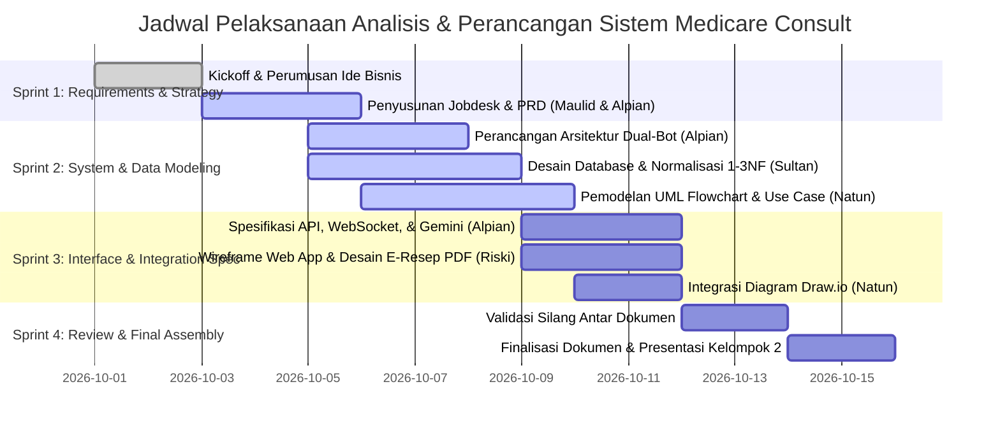

# 📋 Dokumen Pembagian Kerja (Jobdesk) — Kelompok 2
## Proyek: Analisis & Perancangan Sistem (APS) — Medicare Consult
> **Mata Kuliah:** Analisis & Perancangan Sistem / Rekayasa Perangkat Lunak  
> **Tema:** Health (Telemedicine & Konsultasi Kesehatan Daring)  
> **Platform:** Medicare Consult (Web-based Healthcare Consultation Platform)  
> **Repository Kerja:** `d:\Development\Carely\docs\Analisis-Perancangan-Sistem\`

---

## 👥 Profil Kelompok 2
Kelompok 2 terdiri dari 5 anggota dengan pembagian peran berimbang sesuai dengan siklus hidup pengembangan sistem (*Software Development Life Cycle* — SDLC) dan pendekatan *User-Centered Design* (UCD):

| No | Nama Anggota | Peran Utama (*Core Role*) | Fokus Tanggung Jawab Utama |
|---|---|---|---|
| 1 | **Alpian** | **Project Leader & Lead System Architect** | Koordinasi proyek, arsitektur sistem 3-tier, arsitektur *dual-bot* (Triage & Gemini), integrasi API/WebSocket, serta orkestrasi *deliverables*. |
| 2 | **Maulid** | **Lead Business Analyst & PRD Specialist** | Analisis alur bisnis Halodoc, identifikasi kebutuhan fungsional/non-fungsional, perumusan taksonomi gejala, dan aturan *gatekeeping* profil medis. |
| 3 | **Sultan** | **Database Administrator & Data Modeler** | Perancangan skema basis data relasional, kamus data (*data dictionary*), pengujian normalisasi (1NF, 2NF, 3NF), dan skrip DDL SQL. |
| 4 | **Natun** | **System Modeler & UML Specialist** | Pemodelan visual sistem: *Flowchart*, *Use Case Diagram* & spesifikasi skenario, *Activity Diagrams*, *Sequence Diagram*, dan penyusunan berkas Draw.io. |
| 5 | **Riski** | **UI/UX Designer & Product Deliverable Lead** | Pemisahan arsitektur *Landing Page* vs *Web App*, *wireframe* antarmuka, alur interaksi *chat room*, dan spesifikasi layout PDF E-Resep resmi. |

---

## 📊 Matriks Tanggung Jawab (RACI Matrix)

Keterangan:
- **R (*Responsible*)**: Anggota yang mengeksekusi dan menyusun dokumen.
- **A (*Accountable*)**: Penanggung jawab akhir atas kelayakan dan kebenaran modul.
- **C (*Consulted*)**: Anggota yang diajak berdiskusi dan memberikan masukan teknis.
- **I (*Informed*)**: Anggota yang menerima pembaruan terkait dokumen tersebut.

| No | Modul / Dokumen Deliverable | Alpian | Maulid | Sultan | Natun | Riski |
|:--:|---|:---:|:---:|:---:|:---:|:---:|
| 1 | **Manajemen Proyek & Jobdesk (`jobdesk.md`, `README.md`)** | **A / R** | C | C | C | C |
| 2 | **Analisis Logika Bisnis & PRD (`01-business-logic-and-prd.md`)** | C | **A / R** | C | C | C |
| 3 | **Arsitektur Sistem & Dual-Bot (`02-system-architecture-and-triage.md`)** | **A / R** | C | C | C | C |
| 4 | **User Journey & Flowchart (`03-user-journey-and-flowcharts.md`)** | C | C | I | **A / R** | C |
| 5 | **Use Case & Activity Diagram (`04-usecase-and-activity-diagrams.md`)** | C | C | I | **A / R** | I |
| 6 | **Database, ERD, & Normalisasi (`05-database-design-erd-normalization.md`)** | C | I | **A / R** | C | I |
| 7 | **Spesifikasi API & Gemini AI (`06-api-websocket-and-gemini-spec.md`)** | **A / R** | C | C | I | C |
| 8 | **UI/UX Wireframe & E-Resep PDF (`07-uiux-wireframe-and-pdf-recipe.md`)** | C | C | I | C | **A / R** |
| 9 | **Paket Berkas Visual Draw.io (`medicare_consult_diagrams.drawio`)** | C | I | C | **A / R** | C |

---

## 📝 Rincian Tanggung Jawab & Deliverables Anggota

### 1. Alpian — Project Leader & Lead System Architect
- **Tanggung Jawab:**
  - Menetapkan arah teknis (*technical roadmap*) dan arsitektur modular sistem Medicare Consult.
  - Merancang arsitektur interaksi bot ganda (*Triage Bot* sebagai penengah $\to$ *Bot Dokter Spesialis* ditenagai Google Gemini AI).
  - Merancang protokol transmisi data *real-time* (WebSocket) untuk ruang percakapan konsultasi dan antrean bot.
  - Memastikan seluruh modul terintegrasi secara kohesif dan memenuhi standar penilaian tugas kuliah APS.
- **Deliverables Utama:**
  - `jobdesk.md` & `README.md` (koordinasi dokumen induk).
  - `02-system-architecture-and-triage.md`.
  - `06-api-websocket-and-gemini-spec.md` (bersama Riski untuk kontrak endpoint UI).

### 2. Maulid — Lead Business Analyst & PRD Specialist
- **Tanggung Jawab:**
  - Melakukan riset komparatif terhadap logika bisnis platform *telehealth* terkemuka (khususnya Halodoc).
  - Merumuskan studi kasus sistem: transformasi dari konsep klinik konvensional menjadi layanan konsultasi daring murni.
  - Menyusun matriks kebutuhan fungsional (FR) dan non-fungsional (NFR) untuk ketiga peran pengguna: Pasien, Dokter (Bot), dan Administrator.
  - Mengelompokkan gejala penyakit secara sistematis: **Gejala Umum** (batuk, demam, pilek, lemas) vs **Gejala Organ Dalam / Spesifik** (paru, lambung/pencernaan, jantung, saraf, kulit).
  - Mendefinisikan aturan *gatekeeping* profil: "Data pasien wajib lengkap 100% sebelum dapat memilih layanan atau memulai konsultasi".
- **Deliverables Utama:**
  - `01-business-logic-and-prd.md`.
  - Bagian studi kasus dan batasan ruang lingkup pada `README.md`.

### 3. Sultan — Database Administrator & Data Modeler
- **Tanggung Jawab:**
  - Mengidentifikasi seluruh entitas, atribut, dan relasi bisnis ke dalam model data relasional.
  - Memimpin tahapan normalisasi data dari bentuk mentah (*Unnormalized Form / UNF*), bentuk pertama (1NF), bentuk kedua (2NF), hingga bentuk ketiga (3NF) guna menjamin tidak adanya anomali insersi, pembaruan, maupun penghapusan.
  - Menyusun Kamus Data (*Data Dictionary*) yang merinci tipe data, panjang karakter, batasan (*primary key, foreign key, not null, unique, enum*), serta fungsi setiap kolom.
  - Menulis skrip DDL SQL lengkap (kompatibel untuk PostgreSQL & MySQL) dan diagram relasi fisik (*Physical ERD*).
- **Deliverables Utama:**
  - `05-database-design-erd-normalization.md`.
  - Skrip DDL SQL inisialisasi basis data `medicare_consult.sql`.

### 4. Natun — System Modeler & UML Specialist
- **Tanggung Jawab:**
  - Memodelkan alur proses bisnis secara visual menggunakan standar notasi UML dan flowchart BPMN.
  - Merancang *Flowchart End-to-End*: registrasi $\to$ pengisian profil $\to$ pemilihan gejala $\to$ triage bot $\to$ konsultasi dokter bot $\to$ generasi e-resep PDF.
  - Merancang *Use Case Diagram* lengkap beserta tabel spesifikasi skenario *use case* (aktor, prekondisi, alur normal, alur alternatif, dan postkondisi).
  - Merancang *Activity Diagrams* untuk 4 proses bisnis krusial.
  - Mengemas seluruh diagram ke dalam berkas siap buka di Draw.io (`medicare_consult_diagrams.drawio`) agar mempermudah tim saat sesi presentasi.
- **Deliverables Utama:**
  - `03-user-journey-and-flowcharts.md`.
  - `04-usecase-and-activity-diagrams.md`.
  - `medicare_consult_diagrams.drawio` (berkas XML Draw.io).

### 5. Riski — UI/UX Designer & Product Deliverable Lead
- **Tanggung Jawab:**
  - Mendefinisikan arsitektur pemisahan halaman: *Landing Page* publik (`index2.html`) sebagai portal informasi & pendaftaran $\leftrightarrow$ *Web App / CRM* privat sebagai antarmuka operasional setelah pengguna berhasil masuk (*login*).
  - Merancang peta situs (*sitemap*) navigasi aplikasi untuk peran Pasien dan Admin.
  - Menyusun *wireframe* tata letak (antarmuka dasbor pasien, formulir kelengkapan biodata, selektor gejala, dan ruang *chatting* dokter bot).
  - Merancang tata letak dan konten standar dokumen **E-Resep Digital (PDF)** yang memuat kop resmi Medicare Consult, nomor SIP dokter bot, data pasien, daftar obat (nama, dosis, aturan pakai), QR Code validasi, dan disclaimer hukum kesehatan.
- **Deliverables Utama:**
  - `07-uiux-wireframe-and-pdf-recipe.md`.
  - Desain layout ASCII wireframe dan struktur data cetak PDF.

---

## 📅 Rencana Timeline & Sprint Pengerjaan (4 Sprint)

---

## 🎯 Standar Kualitas & Definisi Selesai (*Definition of Done*)
Setiap modul dalam dokumentasi APS ini dinyatakan selesai (*Done*) jika memenuhi kriteria berikut:
1. **Kejelasan Bahasa**: Menggunakan Bahasa Indonesia formal akademik dengan istilah teknis rekayasa perangkat lunak yang baku.
2. **Keterhubungan (*Traceability*)**: Entitas di PRD harus terhubung dengan Use Case, Flowchart, tabel pada Database, dan rute pada API.
3. **Diagram Lengkap**: Memiliki visualisasi Mermaid yang dapat dirender di Markdown serta padanannya dalam format Draw.io.
4. **Bebas Kontradiksi**: Aturan bisnis (misal: syarat wajib isi profil pasien) tercermin konsisten pada PRD, Flowchart, Activity Diagram, skema database, dan antarmuka pengguna.
